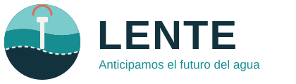

<p align="left"></p>


[](https://danpc11.github.io/LENTE/)

**Inteligencia hidrogeológica para proteger la infraestructura hídrica del turismo costero.**

LENTE transforma datos públicos, modelado físico y monitoreo en campo en una respuesta concreta para cada operador: qué pozos están expuestos a la intrusión salina, cómo evoluciona esa exposición con el bombeo y qué decisiones la reducen. No vendemos mapas ni sensores; vendemos continuidad operativa del abastecimiento de agua.

**Explora la plataforma:** https://danpc11.github.io/LENTE/

34,413 pozos georreferenciados en la península · 1,802 pozos de servicios analizados · 179 captaciones por encima del umbral crítico calculado · 142 titulares identificados como prospectos en la costa de Quintana Roo.

## La oportunidad

La Riviera Maya sostiene una de las industrias turísticas más grandes de América Latina sobre un recurso que conocemos de forma fragmentada: una lente de agua dulce de pocas decenas de metros que flota sobre el mar. El sector servicios de Quintana Roo tiene concesionada más agua subterránea que el abasto público urbano de todo el estado y la extrae desde pozos someros en la franja donde esa lente es más delgada. Cuando la haloclina alcanza la rejilla, el agua sale salobre y el operador paga ósmosis inversa, pipas o un pozo nuevo, sin aviso previo. Hoy ningún punto de la costa mide salinidad de forma continua y los estudios hidrogeológicos privados responden una vez, para un pozo, a un costo que solo pagan los grandes. El riesgo es climático y crece: nivel del mar, marejadas de huracán y sequías adelgazan la lente; el bombeo decide cuándo se rompe.

## La tecnología

| Componente | Qué hace | Estado |
| --- | --- | --- |
| **LENTE Atlas** | Ubica y clasifica por vulnerabilidad cada pozo de servicios de la península con el padrón oficial (REPDA) y un criterio físico de ascenso de la haloclina; simulador de reducción de bombeo por pozo | Disponible |
| **LENTE Monitor** | Sensores de conductividad, nivel y caudal en pozos piloto, con lecturas cada hora, para calibrar el modelo y verificar la clasificación | Próxima etapa (pilotos) |
| **LENTE Forecast** | Modelo físico del acuífero (MODFLOW 6, flujo de densidad variable) ampliado a emulador y análisis de sensibilidad, para pronóstico por pozo con incertidumbre | En desarrollo |

La clasificación del Atlas es física, no una medición de salinidad; la ventaja que se construye con cada piloto es el historial de calibración con datos propios.

## Mercado

Inicial: hoteles, parques turísticos, aeropuerto, desarrolladores inmobiliarios y operadores de infraestructura de la Riviera Maya. Expansión: destinos turísticos con acuíferos costeros kársticos en el Caribe y el Mediterráneo.

Desarrollado en México para una industria turística resiliente.

---

## Documentación técnica

Metodología: [docs/metodologia.md](docs/metodologia.md). Propuesta al Premio a la Innovación Mexicana 2026: [docs/LENTE_propuesta.pdf](docs/LENTE_propuesta.pdf).

```
data/raw/        exportaciones REPDA 2026, pozos REPDA 2011 por estado, costa 2024 (GeoJSON)
data/processed/  títulos limpios, cruce 2011-2026, índice de riesgo por pozo, piezómetros, capas geo
scripts/         01 descarga · 02 limpieza · 03 cruce · 04 índice de riesgo · 05 app · 06 figura del modelo
model/           lente_mf6.py (MODFLOW 6) y results/*.json
app/             template.html, d3 incrustado y lente_app.html (autocontenida, funciona sin red)
docs/            index.html (web app publicada), propuesta en PDF y HTML, metodología
figures/         figuras y capturas de la app
brand/           logotipo (SVG y PNG) y paleta
```

### Reproducir

```bash
pip install -r requirements.txt
make download   # REPDA 2011 por REST (necesita red)
make data       # limpieza, cruce e índice de riesgo
make mf6        # binario MODFLOW 6.6.1 para Linux; en macOS usa mf6.6.1_mac.zip del mismo release
make model      # seis escenarios, unos 4 minutos
make figures app
```

Las exportaciones del REPDA 2026 se hacen a mano en la [consulta en línea de CONAGUA](https://app.conagua.gob.mx/ConsultaRepda.aspx) (búsqueda avanzada por tipo de aprovechamiento, estado y uso) y se dejan en `data/raw/`.

### Fuentes

- CONAGUA: REPDA (consulta en línea 2026; servicio REST `sigagis.conagua.gob.mx`, aprovechamientos subterráneos 2011), red piezométrica 2025, disponibilidad del acuífero Península de Yucatán (DOF 2023), diagnóstico de calidad del agua 2012-2023.
- CONABIO: línea de costa de México 2024, manglares 2025 y cambios 2020-2025, cuerpos de agua 1:50 000.
- Natural Earth 1:10 m: batimetría y ríos.
- Bauer-Gottwein et al. (2011) *Hydrogeology Journal*; Beddows et al. (2007) *Journal of Hydrology*.

## Licencia

Uso restringido: se permite consultar el código y los documentos y ejecutar los scripts para verificar resultados; cualquier otro uso (comercial, redistribución, obras derivadas, despliegue) requiere licencia escrita de los titulares. Ver [LICENSE](LICENSE). Los datos de CONAGUA y CONABIO conservan sus términos.
