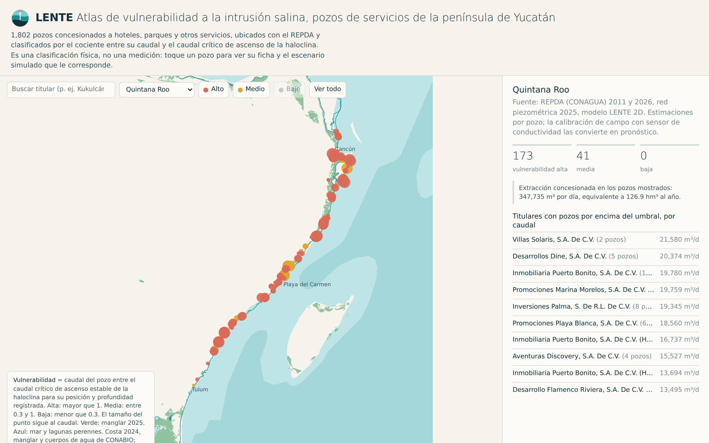

<p align="left"></p>


[](https://danpc11.github.io/LENTE/)
[](docs/LENTE_propuesta.pdf)


[](LICENSE)

**Pronóstico de intrusión salina en los pozos que abastecen al turismo de la península de Yucatán.**

**Web app:** https://danpc11.github.io/LENTE/

[](https://danpc11.github.io/LENTE/)

*LENTE Atlas: clasificación de vulnerabilidad de los pozos de servicios entre Cancún y Tulum.*

## Por qué importa

La península de Yucatán no tiene ríos. Toda el agua que se bebe, se riega o llena una alberca sale del mismo acuífero de roca caliza, y bajo la costa del Caribe esa agua dulce es una lente de pocas decenas de metros que flota sobre el mar. Cada pozo que bombea levanta la frontera entre ambas, la haloclina, hacia su rejilla; cuando la alcanza, el agua sale salobre y el hotel paga ósmosis inversa, pipas o un pozo nuevo. Nadie le avisa antes.

El sector servicios de Quintana Roo (hoteles, parques, aeropuerto, plazas) tiene concesionada más agua subterránea que el abasto público urbano de todo el estado, y la bombea desde pozos someros en la franja donde la lente es más delgada. El mismo hotel inyecta su agua residual tratada por debajo de la lente. Frente a esa presión, la vigilancia pública no mide salinidad de forma continua en ningún punto de la costa, y los estudios hidrogeológicos privados responden una vez, para un pozo, a un costo que solo pagan los grandes.

LENTE convierte ese problema en un sistema de alerta temprana por pozo, en tres componentes: **Atlas** (existe hoy) ubica y clasifica por vulnerabilidad cada pozo de servicios de la península con el padrón oficial de concesiones (REPDA) y un criterio físico de ascenso de la haloclina; **Monitor** (siguiente paso) instala sensores de conductividad, nivel y caudal en pozos piloto para calibrar el modelo y verificar la clasificación; **Forecast** (etapa posterior) usa el modelo físico del acuífero (MODFLOW 6, flujo de densidad variable) para dar pronóstico por pozo con incertidumbre. La clasificación del Atlas es física, no una medición de salinidad.

El riesgo es climático: el nivel del mar sube, las marejadas de huracán empujan agua salada al acuífero y las sequías reducen la recarga. Cada uno adelgaza la lente; el bombeo decide cuándo se rompe. Proteger la lente es proteger la infraestructura de la principal industria de la región y el agua de las comunidades que viven de ella.

## Qué hay en el repositorio

```
data/raw/        exportaciones REPDA 2026, pozos REPDA 2011 por estado, costa 2024 (GeoJSON)
data/processed/  títulos limpios, cruce 2011-2026, índice de riesgo por pozo, piezómetros, capas geo
scripts/         01 descarga · 02 limpieza · 03 cruce · 04 índice de riesgo · 05 app · 06 figura del modelo
model/           lente_mf6.py (MODFLOW 6) y results/*.json
app/             template.html y lente_app.html (autocontenida)
docs/            index.html (web app publicada), propuesta en PDF y HTML, metodología
figures/         figuras y capturas de la app
brand/           logotipo (SVG y PNG) y paleta
```

Cómo se calcula cada pieza: [docs/metodologia.md](docs/metodologia.md). Propuesta completa: [docs/LENTE_propuesta.pdf](docs/LENTE_propuesta.pdf).

## Reproducir

```bash
pip install -r requirements.txt
make download   # REPDA 2011 por REST (necesita red)
make data       # limpieza, cruce e índice de riesgo
make mf6        # binario MODFLOW 6.6.1 para Linux; en macOS usa mf6.6.1_mac.zip del mismo release
make model      # seis escenarios, unos 4 minutos
make figures app
```

Las exportaciones del REPDA 2026 se hacen a mano en la [consulta en línea de CONAGUA](https://app.conagua.gob.mx/ConsultaRepda.aspx) (búsqueda avanzada por tipo de aprovechamiento, estado y uso) y se dejan en `data/raw/`.

## Fuentes

- CONAGUA: REPDA (consulta en línea 2026; servicio REST `sigagis.conagua.gob.mx`, aprovechamientos subterráneos 2011), red piezométrica 2025, disponibilidad del acuífero Península de Yucatán (DOF 2023), diagnóstico de calidad del agua 2012-2023.
- CONABIO: línea de costa de México 2024, manglares 2025 y cambios 2020-2025, cuerpos de agua 1:50 000.
- Natural Earth 1:10 m: batimetría y ríos.
- Bauer-Gottwein et al. (2011) *Hydrogeology Journal*; Beddows et al. (2007) *Journal of Hydrology*.

## Equipo

Daniel Pérez Calixto (INMEGEN) y Sandra Michelle Torres Pantoja. Postulación al Premio a la Innovación Mexicana 2026, edición Mérida, categoría regional 1 (turismo sostenible y resiliencia climática).

## Licencia

Uso restringido: consulta y evaluación permitidas; cualquier otro uso requiere licencia escrita de los titulares. Ver [LICENSE](LICENSE). Los datos de CONAGUA y CONABIO conservan sus términos.
